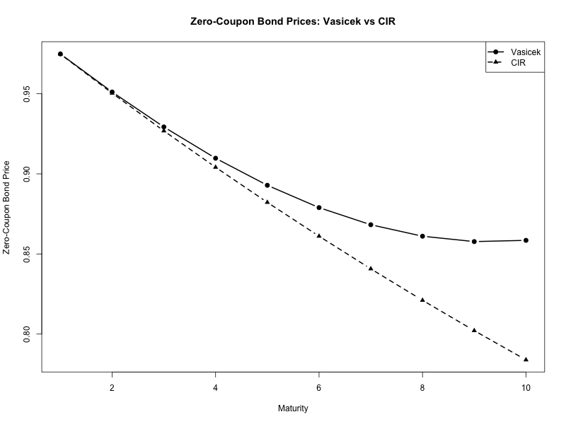
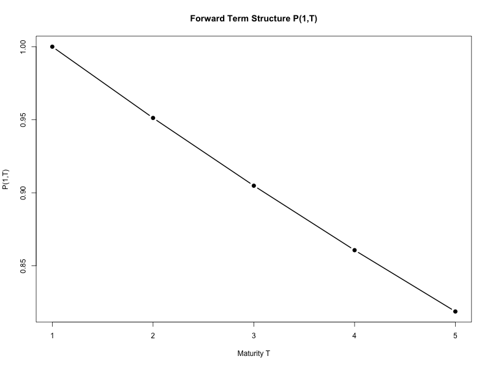
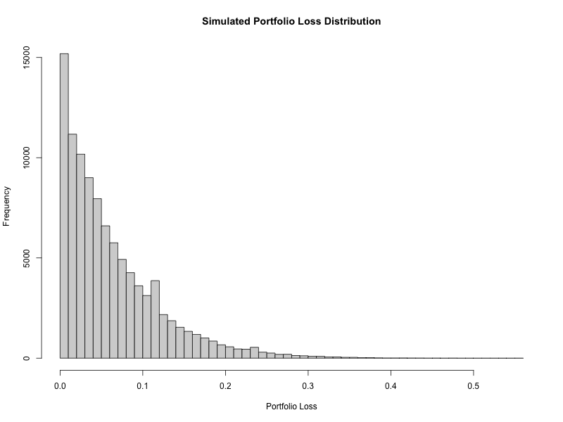
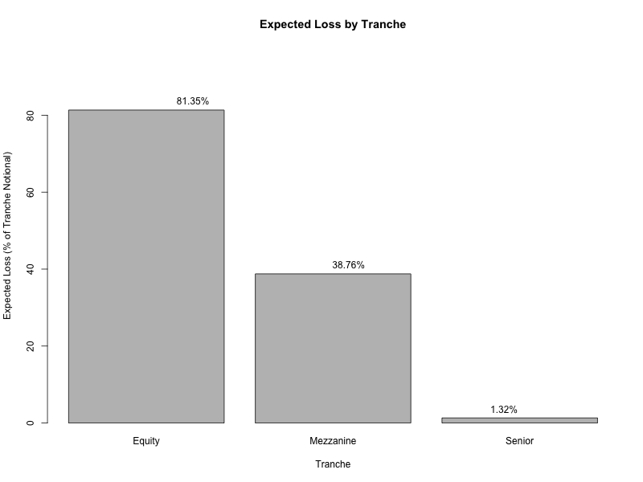

# Interest-Rate & Credit Derivatives in R

A set of six self-contained quantitative problems in **fixed income and credit
derivatives**, implemented in R. Covers short-rate models, quanto adjustment, CDS
calibration, a two-factor Gaussian model, Gaussian-copula portfolio credit risk, and
curve interpolation with a duration–convexity hedge.

Developed as the final project for **FE 680 – Advanced Derivatives** at Stevens
Institute of Technology.

---

## What's inside

| # | Problem | Methods |
|---|---|---|
| 1 | **Vasicek vs. CIR zero-coupon bonds** | Closed-form affine bond prices `P(0,T)=A·e^(−B·r₀)`; continuously-compounded yields across maturities 1–10y. |
| 2 | **Quanto swap valuation** | USD vs. JPY-settled swap; discount factors and the quanto convexity adjustment `exp(−ρ·σ_S·σ_X·T)`. |
| 3 | **CDS hazard- & recovery-rate calibration** | Bootstraps the hazard rate `λ` from a binary CDS spread by root-finding (`uniroot`) over premium, accrued, and default legs; backs out the recovery rate from the vanilla spread. |
| 4 | **Hull–White two-factor model** | Forward term structure `P(1,T)`, factor loadings `B₁,B₂`, and zero-rate volatility `σ_R(1,T)` from the correlated two-factor dynamics. |
| 5 | **Gaussian-copula CDO tranche losses** | Monte-Carlo one-factor Gaussian copula over 125 names (100k paths); portfolio loss distribution and expected losses on the equity / mezzanine / senior tranches. |
| 6 | **Curve interpolation + duration–convexity hedge** | Natural cubic spline for a 3-year yield; solves a 3×3 system to immunize a bond against first- and second-order rate moves. |

## Methods & models

- **Short-rate models.** Vasicek and Cox–Ingersoll–Ross (CIR) use their affine
  closed-form bond-price solutions; the CIR `A` term uses `γ = √(a²+2σ²)`. Yields are
  `y(T) = −ln P(0,T)/T`.
- **Quanto adjustment.** The yen-settled value is scaled by
  `exp(−ρ·σ_S·σ_X·T)` to correct for the correlation between the swap rate and the
  FX rate.
- **Credit / CDS.** The premium, accrued, and default legs are discounted survival-
  weighted; `uniroot` calibrates `λ` to match the observed binary spread, and the
  recovery rate follows from `R = 1 − s_CDS / s_binary`.
- **Hull–White 2-factor.** Factor loadings `B₁`, `B₂` and the bond-price volatility
  `σ_P` combine (with correlation `ρ`) into the zero-rate volatility `σ_R = σ_P/τ`.
- **Portfolio credit risk.** A one-factor Gaussian copula couples 125 obligors through
  a common factor `Z` (correlation `ρ = 0.25`); default times come from
  `τ = −ln U / λ`. Tranche losses use `min(max(L−A,0), D−A)` with 40% recovery.
- **Immunization.** A natural cubic spline interpolates the 3-year zero; a 3×3 linear
  system matches price, first-, and second-order sensitivities to hedge the position.

## Selected figures

Bond prices (Vasicek vs. CIR) and the CDO portfolio loss distribution:

| | |
|---|---|
|  |  |
|  |  |

All figures are in [`figures/`](figures/); the full knitted report with tables and
numeric results is in [`docs/FE680_final_report.pdf`](docs/FE680_final_report.pdf).

## Repository layout

```
.
├── fe680_final.Rmd     # All six problems, one R Markdown source
├── figures/            # Result plots (PNG)
├── docs/               # Knitted PDF report (tables + figures + output)
└── README.md
```

## Running it

Requires **R** (≥ 4.0) with `rmarkdown` and `knitr`; everything else uses base R
(`splinefun`, `uniroot`, `solve`). No other packages are needed.

```r
install.packages(c("rmarkdown", "knitr"))   # once
rmarkdown::render("fe680_final.Rmd")         # produces the PDF report
```

Or open `fe680_final.Rmd` in RStudio and click **Knit**. Problem 5 sets
`set.seed(123)` so the Monte-Carlo results are reproducible.

## Author

**Om Patel** — B.S. Quantitative Finance, Stevens Institute of Technology.
